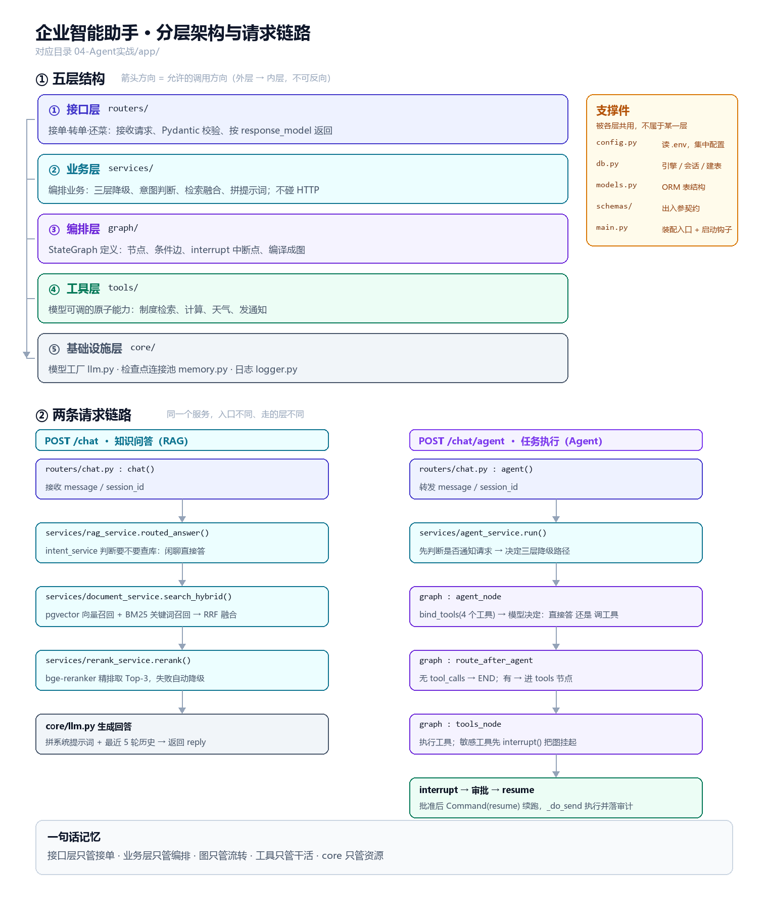

# 企业智能助手 · Enterprise Agent Assistant

基于 **LangGraph** 的可控 Agent 与 RAG 知识问答服务：模型自主调用工具，敏感操作走人工审批闭环，会话状态持久化到 PostgreSQL，全链路分层可测试。


## 功能特性

- **RAG 知识问答**：意图路由判断是否需要检索 → 向量召回 + BM25 关键词召回 → RRF 融合 → Reranker 精排 → 生成回答
- **Agent 工具调用**：基于 `StateGraph` 的 ReAct 循环，模型在 4 个工具（制度检索 / 计算器 / 天气 / 发通知）中自主决策
- **人工审批闭环**：敏感工具执行前用 `interrupt()` 挂起图，管理员批准后 `Command(resume=...)` 恢复，拒绝则不执行
- **多轮记忆与会话隔离**：检查点持久化到 PostgreSQL，通过 `thread_id` 隔离不同会话，服务重启后可继续对话
- **降级与兜底**：模型未按预期调用工具时，按「提示词约束 → 强制重试 → 确定性解析」三层兜底；Rerank 与天气工具不可用时自动降级
- **权限控制**：JWT 认证 + 角色校验（admin / user），审批与知识库管理接口仅管理员可用
- **零构建前端**：内置两个静态页面（对话页 / 管理页），纯 HTML + 原生 JS

## 架构



服务按职责分为五层，依赖方向单向（外层可调内层，内层不可反向）：

| 层 | 目录 | 职责 |
|---|---|---|
| 接口层 | `app/routers/` | 接收请求、参数校验、按 schema 返回 |
| 业务层 | `app/services/` | 编排业务：意图判断、检索融合、三层降级、审批 |
| 编排层 | `app/graph/` | 定义 StateGraph：节点、条件边、中断点 |
| 工具层 | `app/tools/` | 模型可调用的原子能力 |
| 基础设施层 | `app/core/` | 模型工厂、检查点连接池、日志 |

横切支撑：`config.py`（配置）、`db.py`（引擎/建表）、`models.py`（ORM）、`schemas/`（出入参契约）、`main.py`（装配）。

## 技术栈

| 分类 | 技术 |
|---|---|
| Agent 编排 | LangGraph 1.2、LangChain 1.4 |
| 检索增强 | pgvector、BAAI/bge-m3、BM25（jieba）、RRF、BAAI/bge-reranker-v2-m3 |
| Web 服务 | FastAPI、Uvicorn、SSE |
| 持久化 | PostgreSQL + pgvector、SQLAlchemy 2.x、psycopg 3 |
| 鉴权 | python-jose（JWT）、bcrypt |
| 工程化 | pytest、loguru、GitHub Actions |

## 快速开始

### 1. 环境要求

- Python 3.10+
- PostgreSQL 14+ 并安装 `pgvector` 扩展（或使用 Neon 等云端 PostgreSQL）

### 2. 安装依赖

```bash
python -m venv .venv
# Windows
.venv\Scripts\activate
# macOS / Linux
source .venv/bin/activate

pip install -r requirements.txt
```

### 3. 配置环境变量

```bash
cp .env.example .env
```

至少填写三项：

| 变量 | 说明 |
|---|---|
| `LLM_API_KEY` | 对话模型密钥（OpenAI 兼容接口） |
| `EMBEDDING_API_KEY` | 向量化模型密钥 |
| `DATABASE_URL` | PostgreSQL 连接串，需含 `+psycopg` 驱动前缀 |

> `EMBEDDING_DIM` 必须与向量模型输出维度一致（bge-m3 为 1024），否则入库报错。

### 4. 准备数据库

需要一台启用了 `pgvector` 扩展的 PostgreSQL。推荐使用云端托管（如 Neon、Supabase）：创建实例后，把带 `sslmode=require` 的连接串填入 `DATABASE_URL` 即可，无需本地安装数据库。

启动时服务会自动执行 `CREATE EXTENSION IF NOT EXISTS vector`、建表、创建初始管理员并完成知识库入库。

### 5. 启动服务

```bash
uvicorn app.main:app --reload --port 8000
```

| 地址 | 说明 |
|---|---|
| http://127.0.0.1:8000/ | 对话页面 |
| http://127.0.0.1:8000/admin | 管理页面（用户、知识库、审批记录） |
| http://127.0.0.1:8000/docs | OpenAPI 文档 |

默认管理员账号见 `.env` 的 `ADMIN_USERNAME` / `ADMIN_PASSWORD`。

## API 一览

| 方法 | 路径 | 权限 | 说明 |
|---|---|---|---|
| GET | `/health` | 公开 | 健康检查 |
| POST | `/chat` | 公开 | RAG 问答（非流式） |
| POST | `/chat/stream` | 公开 | RAG 问答（SSE 流式） |
| POST | `/chat/agent` | 公开 | Agent 执行；命中敏感工具时返回待审批状态 |
| POST | `/chat/agent/approve` | 管理员 | 批准或拒绝待审批的工具调用 |
| POST | `/auth/login` | 公开 | 登录（form 表单，返回 JWT） |
| POST | `/auth/register` | 公开 | 注册 |
| GET | `/auth/me` | 登录 | 当前用户信息 |
| POST | `/auth/me/avatar/upload` | 登录 | 上传头像 |
| GET | `/auth/users` | 管理员 | 用户列表 |
| PATCH | `/auth/users/{id}/role` | 管理员 | 修改角色 |
| DELETE | `/auth/users/{id}` | 管理员 | 删除用户 |
| GET/POST | `/admin/documents` | 管理员 | 知识库文档列表 / 上传 |
| GET | `/admin/approvals` | 管理员 | 审批记录（追加式审计） |

## 测试

```bash
pip install -r requirements-dev.txt
pytest -q
```

预期结果：`29 passed, 3 skipped`。

- 覆盖范围：通知请求路由判断、收件人解析、文档切分、RRF 融合、工具函数、接口校验与权限拦截
- 全部用例不依赖真实 API 与数据库，离线可跑
- 3 个跳过用例来自 `tests/test_document_service.py`，需要 PostgreSQL 环境；建好库后去掉该文件的 `skipif` 即可启用

## 评测

```bash
python evaluate.py
```

用固定问题集 + 期望关键词的方式对 RAG 链路打分，输出每题命中情况与总分。改动切分策略、召回参数或 Rerank 配置后重跑，用于回归对比。

## 部署

以 `uvicorn app.main:app --host 0.0.0.0 --port 8000` 运行，前置 Nginx 反向代理并配置 HTTPS；数据库使用云端 PostgreSQL。

**生产注意事项**

- `JWT_SECRET` 必须替换为随机值，否则令牌可被伪造
- 检查点连接使用连接池并开启探活，云数据库空闲挂起后可自愈
- 知识库文档放在 `data/` 目录，服务启动时自动入库

## 目录结构

```
.
├── app/
│   ├── core/          # 模型工厂、检查点连接池、日志
│   ├── graph/         # StateGraph 定义（state / workflow）
│   ├── routers/       # chat / auth / admin 接口
│   ├── schemas/       # Pydantic 出入参
│   ├── services/      # agent / rag / document / intent / rerank
│   ├── static/        # 对话页与管理页
│   ├── tools/         # 4 个工具实现
│   ├── auth.py        # JWT 签发与校验
│   ├── config.py      # 配置读取
│   ├── db.py          # 数据库引擎与建表
│   ├── main.py        # 应用装配与启动钩子
│   └── models.py      # ORM 模型
├── data/              # 知识库文档
├── docs/              # 架构图
├── tests/             # pytest 用例
├── evaluate.py        # RAG 评测脚本
├── requirements.txt
└── .env.example
```

## 设计要点

**为什么单轮问答不套 LangGraph？** `/chat` 走的是线性链路（路由 → 检索 → 生成），用状态机是过度设计；`/chat/agent` 需要循环与中断，才用 `StateGraph`。两套入口共用一个服务，各自用合适的抽象。

**为什么要混合检索？** 纯向量检索对专有名词、编号类问题召回不稳，加入 BM25 后用 RRF 融合两路排名，兼顾语义与字面命中。

**为什么只给一个工具加审批？** 4 个工具中只有"发通知"会产生不可撤回的对外副作用，用白名单 `APPROVAL_TOOLS` 精确控制审批面，避免所有工具都弹窗导致体验崩塌。

**为什么需要三层降级？** 工具调用是模型给出的建议而非保证，"声称已发送但实际未调用"是真实会发生的失败模式。提示词约束 → 强制重试 → 正则确定性兜底，保证关键操作不会静默丢失。

## License

[MIT](LICENSE)